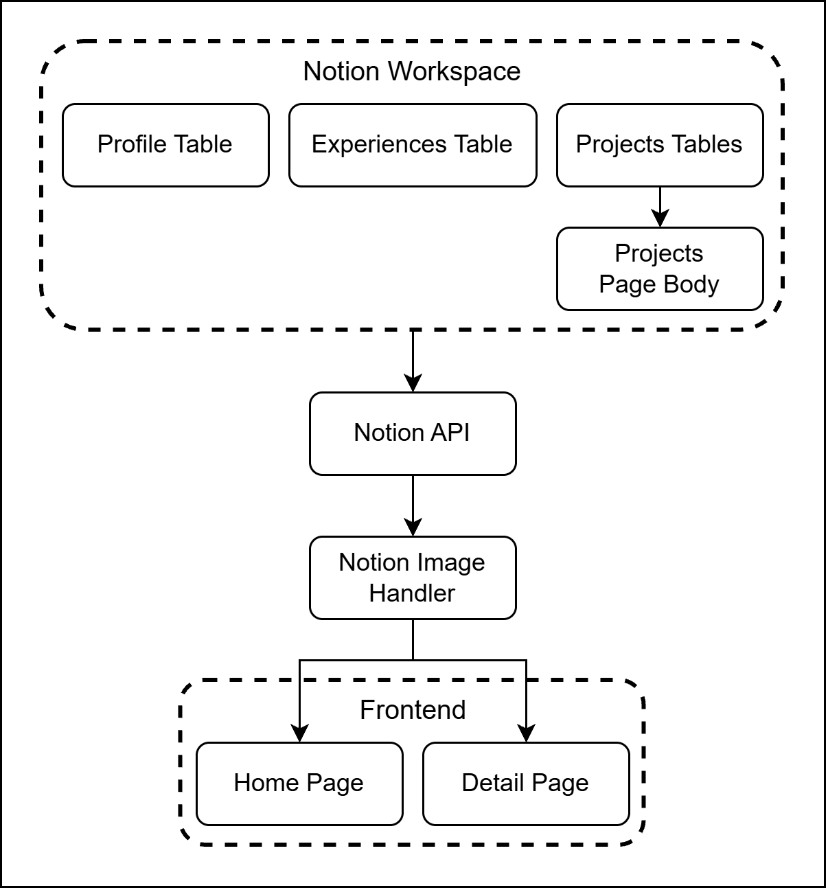

# My Portfolio


A personal portfolio site built with **Next.js** and powered entirely by **Notion as a headless CMS**. Profile info, work experience, and project write-ups are authored directly in Notion and rendered

## Features

- **Live content** - Contents are fetched straight from Notion API and cached with Next.js `"use cache"`
- **Image-safe** - Notion's file URLs are signed S3 links that expire after ~1 hour. A dedicated proxy resolves a fresh URL on every access and redirects to it, so images never break regardless of how long content has been cached.
- **Rich project** - Each project's Notion page body (headings, paragraphs, code blocks, captioned images) is rendered as a full blog-style article.

## Architecture Overview



## Data Model (Notion)

| Database | Key properties |
|---|---|
| **Profile** | Name, role, region, about, skills (multi-select), cover (file image) |
| **Experience** | Company, role, start_date, end_date |
| **Projects** | Title, description, category (multi-select), Cover Image (file image), published_date, Tech Stack (multi-select), Github / Website / Drive / Kaggle (URL), Status (Draft/Published) |

Each Projects row is also a full Notion page — its body content (written like a normal document, with `## ` headings, paragraphs, code blocks, and images with captions) becomes that project's detail-page article.

Only rows with `Status = Published` are ever fetched, so draft projects never reach the live site.

## Image Handling

Images are never re-hosted or copied to disk. Instead:

1. A project's cover or body image is referenced in the generated content as `/api/notion-image?type=cover|block&id=<pageId|blockId>`.
2. On each request, the route looks up the image's **current** signed URL from Notion (via `pages.retrieve` or `blocks.retrieve`) and issues an HTTP redirect to it.
3. The lookup itself is cached (`"use cache"`, short TTL kept safely under Notion's ~1-hour signed-URL expiry), so most requests resolve instantly without hitting the Notion API.

This avoids both the "images break after an hour" problem and the need for a third-party image host.

## Theming

Colors throughout the UI use daisyUI's semantic (`primary`, `secondary`, `base-100/200/300`, `base-content`, etc.)

The theme toggle lives once in the root layout (not duplicated per page) and persists the chosen theme to `localStorage`, falling back to the OS color-scheme preference on first visit.

## Getting Started

### Environment variables

```
NOTION_SECRET=
NOTION_PORTFOLIO_DATASOURCE_ID=
NOTION_EXPERIENCE_DATASOURCE_ID=
NOTION_PROFILE_DATASOURCE_ID=
REVALIDATE_SECRET=
```

### Install & run

```bash
npm install
npm run dev
```

### Notion setup

1. Create a Notion internal integration and share your Profile, Experience, and Projects databases with it.
2. Each database must be queried by its **data source ID**. Retrieve it via `notion.databases.retrieve()` or copy it directly from the database's "Manage data sources" menu in the Notion UI.

## Deployment

Deployed on **Vercel**, required for server-side features this project relies on.